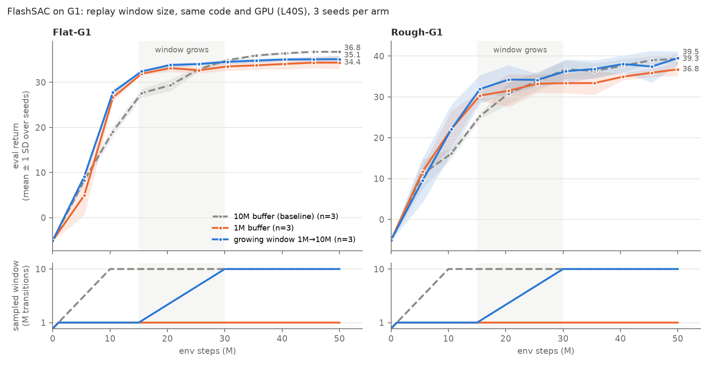

# Growing replay window (Jaehoon)

Question: a small replay buffer learns faster early but ends lower (FlashSAC ablation, and our 1M control).
Can a window that grows keep the early gain and lose the late cost?

## Arms (G1 only, 3 seeds each: 0, 1000, 2000; same code b34f01a and GPU, g6e.xlarge L40S)
| exp | what it samples from | override |
|---|---|---|
| `uniform_d2` | all of the 10M buffer (FlashSAC baseline) | none |
| `buffer_1M` | all of a 1M buffer | `agent.buffer_max_length=1_000_000` |
| `window_1to10M` | the newest W transitions of the 10M buffer; W = 1M until 15M env steps, then linear to 10M at 30M | `agent.sampler=window` |

Before 15M steps the window arm runs the same algorithm as `buffer_1M`; from 30M on it runs the same as `uniform_d2`.

## Result (mean of Flat-G1 and Rough-G1, relative to the 10M baseline, 95% CI)
| metric | 1M buffer | growing window |
|---|---|---|
| early AUC, 0-20.5M | +17% [+9, +24] | **+22% [+11, +33]** |
| late AUC, 30-50M | -7% [-11, -3] | **-2% [-6.5, +2.5]** |
| full AUC | +0.2% [-3.5, +4] | **+5.1% [-0.2, +10.5]**, p=0.06 |
| final return | -6.5% [-10, -3] | -2% [-5, +1] |

- Per task, full AUC: Flat-G1 +5.4% (p=0.015), Rough-G1 +4.9% (p=0.44, high seed variance).
- Window vs fixed 1M, final return: +4.9% [+0.4, +9.3]. Flat-G1 final is still a little low (-4.4%, p=0.07).
- Cost: train time +4% (0.72 h vs 0.69 h, Flat-G1).
- Safe claim: the growing window keeps the small-buffer early gain without most of its late cost.
  Not yet safe: "better overall". n=3, many comparisons, no correction; the 2-task CIs use a normal approximation.
- Prior work with a similar schedule: ERE (1906.04009) anneals recency to uniform; KataGo (1902.10565) grows its window.

## Files
- `three_arm_G1.png`, `three_arm_stats.csv`: from `python scripts/compare_arms.py` (reads the `*_eval.csv` files here).
- `<exp>_eval.csv`, `<exp>_summary.csv`: from `python scripts/compare_baseline.py --exp <exp> --log_root <logs>`.
- Raw logs, TensorBoard runs and checkpoints are not in git (archives `buffer_1M_results_1124-0307.tar.gz`,
  `window_1to10M_results_1128-0827.tar.gz`, about 225 MB each). Ask Jaehoon for them.
- Run it again: `EXP=window_1to10M ENVS="Isaac-Velocity-Flat-G1-v0 Isaac-Velocity-Rough-G1-v0" scripts/run_baseline.sh agent.sampler=window`
